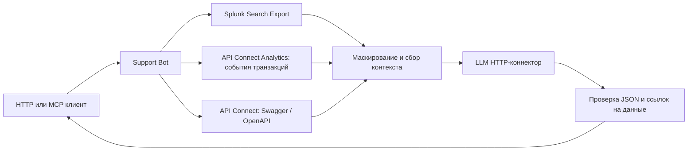

# Support Bot MCP Server

TypeScript-сервер диагностики API-транзакций. Один сервис анализа доступен как MCP-инструмент `analyze_transaction` через Streamable HTTP (`POST /mcp`) и как обычный HTTP API (`POST /api/analyze`).

Целевая версия: **API Connect 10.0.8.10**. Источники — Splunk и нативный Analytics API API Connect, доступный через Platform API host (тот же API используется интерфейсом API Manager). Management API предоставляет спецификации. Прямое подключение к DataPower больше не требуется. LLM-коннектор по умолчанию использует OpenAI-compatible Chat Completions.



## Запуск

Node.js 24+ и npm. Репозиторий уже изолирован в cloud environment; отдельный worktree не требуется.

```sh
npm ci
cp .env.example .env
# Заполнить .env реальными URL и credentials, затем:
npm run dev
```

Сборка: `npm run build`, запуск сборки: `npm start`. Проверки: `npm run typecheck` и `npm test`. `GET /healthz` проверяет только работу HTTP-процесса, доступность внешних систем он не подтверждает.

Все рабочие маршруты требуют `Authorization: Bearer <SERVER_API_KEY>`; ключ не короче 24 символов. В production используйте HTTPS reverse proxy, ограничение доступа и rate limiting. Общий ключ даёт доступ ко всем настроенным источникам; tenant/user RBAC пока не реализован. Origin-запросы браузера запрещены. URL источников задаются только серверной конфигурацией; клиент передаёт идентификаторы и временной диапазон.

## Пример HTTP-запроса

```sh
curl http://127.0.0.1:3000/api/analyze \
  -H "Authorization: Bearer $SERVER_API_KEY" \
  -H 'Content-Type: application/json' \
  -d '{
    "transactionId": "tx-42",
    "apiId": "payments:1.0",
    "from": "2026-11-01T09:00:00Z",
    "to": "2026-11-01T10:00:00Z"
  }'
```

`apiId` — ID опубликованного API в настроенном каталоге; он выбирает спецификацию API/версии, соответствующую транзакции. Для другого способа адресации можно изменить `APIC_SPEC_URL_TEMPLATE`. Нужен явно: только ID транзакции не гарантирует выбор правильной версии контракта. Временной диапазон обязателен, максимум 24 часа. `transactionId` допускает буквы ASCII, цифры и `_.:-`.

Ответ HTTP 200:

```json
{
  "transactionId": "tx-42",
  "apiId": "payments:1.0",
  "diagnosis": {
    "summary": "Отсутствует обязательный заголовок",
    "probableCause": "Gateway отклонил запрос без X-Client-Id",
    "confidence": "high",
    "evidence": [{
      "logId": "splunk:1",
      "specPointer": "/paths/~1payments/post",
      "explanation": "Лог сообщает об отсутствии заголовка, обязательного для операции"
    }],
    "nextSteps": ["Проверить передачу X-Client-Id клиентом"],
    "missingInformation": []
  },
  "sources": { "splunk": 1, "apiConnect": 1, "specification": "API Connect" },
  "warnings": []
}
```

Это пример формата, а не результат проверки реальной транзакции. Причина — вывод LLM, а не детерминированное доказательство. Сервис проверяет формат и существование ссылок, но не истинность рассуждения модели. Без evidence уверенность принудительно `low`.

Ошибки REST: `400` некорректный ввод, `401` авторизация, `403` Origin, `404` нет логов, `422` превышен бюджет контекста/логов, `429` заняты слоты анализа, `502` ошибка источника, спецификации или LLM. Ответ: `{"error":{"code":"...","message":"..."}}`. Ошибка любого обязательного источника прерывает анализ; пустой успешный источник отмечается в `warnings`. MCP сообщает ошибки инструмента через `isError`, согласно протоколу.

## MCP-клиент

URL: `http://127.0.0.1:3000/mcp`, transport: Streamable HTTP, заголовок `Authorization: Bearer ...`. Сервер stateless: initialize, tools/list и tools/call выполняются через POST, без постоянной сессии и SSE GET. `tools/call`:

```json
{
  "jsonrpc": "2.0", "id": 2, "method": "tools/call",
  "params": {
    "name": "analyze_transaction",
    "arguments": {
      "transactionId": "tx-42", "apiId": "payments:1.0",
      "from": "2026-11-01T09:00:00Z", "to": "2026-11-01T10:00:00Z"
    }
  }
}
```

Для ручных запросов нужны `Content-Type: application/json` и `Accept: application/json, text/event-stream`; обычный MCP SDK выполняет handshake и выставляет протокольные заголовки.

## Контракты интеграций и текущие ограничения

- **Splunk**: нативный POST `/services/search/jobs/export`, `Authorization: Splunk ...`, form-urlencoded `search`, `earliest_time`, `latest_time`, `output_mode=json`, `preview=false`. Ответ — JSON Lines с `result`. Индекс и поле транзакции задаёт администратор. На источник максимум 200 событий; при превышении нужно сузить диапазон.
- **API Connect Analytics**: нативный `GET /analytics/{service}/catalogs/{org}/{catalog}/events` на `APIC_PLATFORM_URL`, заголовки `Authorization: Bearer <APIC_TOKEN>` и `Accept: application/json`. Параметры `start`, `end`, `global_transaction_id=equals:<transactionId>` (либо `transaction_id`, если настроено `APIC_TRANSACTION_FIELD`), `limit=100`, `offset`. Точное сравнение через `equals:` не позволяет трактовать ID как оператор поиска. Ответ `{total, events: [...]}`; поддерживаются документированный формат `{id, event: {...}}` и плоские события. Повторно проверяются ID транзакции и `datetime`; ID должен соответствовать выбранному полю. По умолчанию используйте `X-Global-Transaction-Id` / `global_transaction_id`, а не произвольный correlation header. Пагинация обрабатывается до полного набора, максимум 200 событий и 20 запросов. Изменение total, дубликаты ID или неполная выборка дают ошибку, а не частичный диагноз. Требуется право `api-analytics:view` в каталоге. API Connect Analytics должен быть настроен на сохранение событий; доступность payload/headers зависит от activity-log policy, retention и задержки ingestion. Это события API-вызовов, а не системный журнал Manager pod. Если нужны именно системные логи Manager, их нужно получать через платформенную систему логирования, например Splunk.
- **API Connect**: GET по `APIC_SPEC_URL_TEMPLATE`; `{apiId}` URL-кодируется. Шаблон должен указывать на нативный endpoint получения документа, с нужными provider org/catalog/API/version. Ожидается сырой Swagger 2.0 или OpenAPI 3.0/3.1 в JSON/YAML, не ZIP или объект-обёртка. Используется готовый Bearer token; login/refresh, discovery API и выбор catalog пока не реализованы. Внешние `$ref` не загружаются. Для каталога v10 нативный маршрут — `/api/catalogs/{org}/{catalog}/apis/{api-id}/document`; он указан в `.env.example`. Требуется право `product:view`. Выбор org/catalog/service задаёт администратор через конфигурацию; динамический выбор каталога клиентом не реализован.
- **LLM**: OpenAI-compatible Chat Completions API: `model`, `messages`, `response_format=json_object`, `temperature=0`, `max_tokens=2500`; ответ `choices[0].message.content` содержит JSON диагноза. Если ваш коннектор имеет другой контракт, меняется слой `Analyzer`, остальные источники независимы.

Внешние запросы используют таймаут (20 секунд по умолчанию), TLS-проверку, запрет redirect и предел ответа 1 MiB. Контекст LLM ограничен 160 KB; это предел байтов, а не гарантия соответствия token limit любой модели. Конкурентных анализов по умолчанию 4. Скрипты запуска Node используют `--use-env-proxy` для HTTP_PROXY/HTTPS_PROXY; сохраните корпоративные CA через `NODE_EXTRA_CA_CERTS` и добавьте loopback в NO_PROXY при использовании proxy.

Перед отправкой LLM маскируются известные credentials из конфигурации, чувствительные JSON-поля, Bearer/Basic, распространённые текстовые password/token-пары и email. Это базовое маскирование: произвольные персональные данные внутри свободного текста могут остаться. До подключения production-логов согласуйте допустимые данные и добавьте правила под ваш формат. Логи и спецификации передаются как недоверенные данные; prompt запрещает выполнять инструкции из них. Полная защита от prompt injection этим не гарантируется. Исходные данные и тела ошибок внешних сервисов не возвращаются клиенту и не пишутся в консоль.

Тесты выполняют локальный HTTP/MCP handshake и весь pipeline на имитациях Splunk, API Connect Analytics, API Connect Management и LLM; реальные системы и качество диагностики реальной модели требуют отдельной интеграционной проверки.

Добавление следующего инструмента: отдельный сервис обработки и `server.registerTool(...)` в `src/app.ts`. Общие сетевые ограничения находятся в `src/http.ts`, адаптеры источников — в `src/providers.ts`.

## Источники контракта API Connect

Контракт сверён с [официальными API definitions IBM для ветки 10.0.8](https://github.com/ibm-apiconnect/apidocs/blob/55556848f4adc8b179c54cc6213d88e3245e6b6d/v10/10.0.8.LATEST/apis.js): `events_catalogList`, `EventListResponse`, `start`, `end`, `global_transaction_id`, `transaction_id`, `limit`, `offset`, `api_getDocumentCatalogScope`. Отдельного опубликованного файла именно для patch 10.0.8.10 в этом источнике нет; совместимость с вашим установленным patch нужно подтвердить живым запросом.

Пример вызова через Platform API и корреляции по `global_transaction_id` есть в [официальном IBM quick-check](https://github.com/ibm-apiconnect/quick-check/blob/12e04ed9a8c76f096911d4c6309636d60ae6e0fe/api_deploy_check.py#L265). Код примеров не исполняется сервером.

При переходе со старой версии уберите `DATAPOWER_LOGS_URL` / `DATAPOWER_TOKEN` из локального `.env`, добавьте `APIC_PLATFORM_URL`, `APIC_ANALYTICS_SERVICE`, `APIC_ORG`, `APIC_CATALOG`. В HTTP/MCP ответе счётчик источника теперь `sources.apiConnect` вместо `sources.datapower`; идентификаторы evidence этого источника имеют префикс `apic:`. `APIC_TOKEN` используется и для Analytics, и для спецификации.
