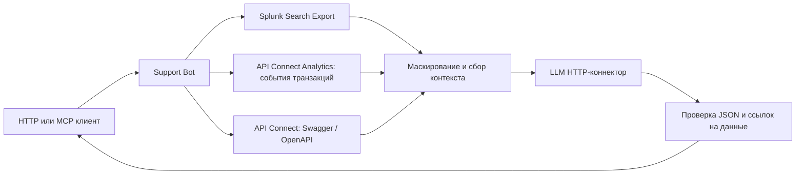

# Support Bot MCP Server

TypeScript-сервер диагностики API-транзакций. Один сервис анализа доступен как MCP-инструмент `analyze_transaction` через Streamable HTTP (`POST /mcp`) и как обычный HTTP API (`POST /api/analyze`).

Контейнеризация и ручное развёртывание на OpenShift: [WP2: build, manifests, policy/CA mounts и проверки](deploy/openshift/README.md). Production image собирается через `docker build -f Containerfile -t support-bot:wp2 .`; повторяемый container smoke test — `node scripts/container-smoke.mjs support-bot:wp2`.

Целевая версия: **API Connect 10.0.8.10**. Источники — Splunk и нативный Analytics API API Connect, доступный через Platform API host (тот же API используется интерфейсом API Manager). Management API предоставляет спецификации. Прямое подключение к DataPower больше не требуется. LLM-коннектор по умолчанию использует OpenAI-compatible Chat Completions.



## Запуск

Node.js 24+ и npm. Репозиторий уже изолирован в cloud environment; отдельный worktree не требуется.

```sh
npm ci
cp .env.example .env
# Заполнить .env реальными URL и credentials, затем:
npm run dev
```

Сборка: `npm run build`, запуск сборки: `npm start`. Проверки: `npm run typecheck` и `npm test`. Публичный `GET /healthz` проверяет только работу HTTP-процесса. Публичный `GET /readyz` возвращает 200 после локальной инициализации и открытия listener, 503 при инициализации или draining. Доступность внешних систем эти endpoints не подтверждают.

### WP2.2: operational logging и lifecycle

Операционные события записываются как JSON Lines: `timestamp` (UTC), `level`, `event`, `requestId`, `interface` (`process`, `REST`, `MCP`), `durationMs`, `outcome`, `errorCode` (`null` при успехе). ID генерируется сервером через UUID, не берётся из клиентского заголовка, JSON-RPC ID или transaction ID. Startup/ready используют общий ID, shutdown started/completed/timeout — другой общий ID; каждый REST request / MCP analysis call имеет собственный ID. Normal events идут в stdout, failures/timeouts — в stderr. Записи небольшие и синхронные, чтобы финальное событие не терялось при exit; медленный log collector может задерживать event loop.

Logger принимает только фиксированные события и коды: credentials, headers, transaction/customer/API IDs, request/response bodies, Splunk events, specs, prompts/completions, URLs и тексты исключений в него не передаются. Неизвестный код заменяется на `INTERNAL_ERROR`; startup failure сообщает только `STARTUP_FAILED`. Это allowlist metadata, а не попытка отредактировать произвольный текст. MCP `isError` и отказы SDK при проверке arguments логируются как failures даже при HTTP 200; успешные initialize/tools/list не считаются анализом. Health/readiness probes не создают analysis logs. REST/MCP auth/body/Origin rejections также дают безопасное failure-событие.

Lifecycle — injectable instance state: initializing → ready → draining → stopped. Config и sanitization policy проверяются до ready. Readiness не выполняет исходящие запросы к Splunk/APIC/LLM, не раскрывает их состояние и не меняет существующие sanitization/auth controls. При draining новый REST/MCP analysis отклоняется с HTTP 503 и безопасным error envelope (`DRAINING`; до ready — `NOT_READY`). Результаты уже начатых анализов и обычные MCP `isError` contracts сохраняются.

SIGINT/SIGTERM синхронно включают draining и вызывают HTTP `server.close()`. Новые соединения перестают приниматься; уже начатые REST/MCP analyses, включая обработку после отключения клиента, могут закончить работу. Shutdown ждёт и завершения HTTP responses, и активных analysis promises. Повторные сигналы не запускают новый timer и не сокращают deadline. По завершении — `shutdown_completed`, exit 0. Только после истечения `SHUTDOWN_TIMEOUT_MS` вызывается `closeAllConnections()`, пишется `shutdown_timeout`, процесс завершается с exit 1.

`SHUTDOWN_TIMEOUT_MS=90000` по умолчанию (целое 1–2147483647 ms); OpenShift `terminationGracePeriodSeconds=105`. Это **best-effort operational budget**, не гарантия завершения любого анализа: pagination и последовательные стадии могут превысить deadline. При изменении budget согласуйте pod grace period, rollout timeout и запас для остановки. `UPSTREAM_TIMEOUT_MS` (20000 по умолчанию), retries, fail-fast provider behavior и бизнес-семантика анализа не изменены. Клиентские disconnects не отменяют analysis; deadline ограничивает ожидание при остановке. Внешний kill/OOM или блокировка event loop могут помешать graceful shutdown.

Тесты WP2.2 используют только synthetic fixtures/mocked upstreams: проверяют отсутствие чувствительных значений в логах, REST/MCP outcomes (включая SDK errors внутри HTTP 200), readiness transitions, запрет новой работы, настоящий SIGTERM во время REST/MCP analysis и idempotence/deadline через injectable clock. Container smoke test и OpenShift admission — отдельные проверки, TypeScript build их не заменяет.

Все рабочие маршруты требуют `Authorization: Bearer <SERVER_API_KEY>`; ключ не короче 24 символов. В production используйте HTTPS reverse proxy, ограничение доступа и rate limiting. Общий ключ даёт доступ ко всем настроенным источникам; tenant/user RBAC пока не реализован. Origin-запросы браузера запрещены. URL источников задаются только серверной конфигурацией; клиент передаёт идентификаторы и временной диапазон.

## Пример HTTP-запроса

```sh
curl http://127.0.0.1:3000/api/analyze \
  -H "Authorization: Bearer $SERVER_API_KEY" \
  -H 'Content-Type: application/json' \
  -d '{
    "transactionId": "tx-42",
    "apiId": "payments:1.0",
    "from": "2026-11-01T09:00:00Z",
    "to": "2026-11-01T10:00:00Z"
  }'
```

`apiId` — ID опубликованного API в настроенном каталоге; он выбирает спецификацию API/версии, соответствующую транзакции. Для другого способа адресации можно изменить `APIC_SPEC_URL_TEMPLATE`. Нужен явно: только ID транзакции не гарантирует выбор правильной версии контракта. Временной диапазон обязателен, максимум 24 часа. `transactionId` допускает буквы ASCII, цифры и `_.:-`.

Ответ HTTP 200:

```json
{
  "transactionId": "tx-42",
  "apiId": "payments:1.0",
  "diagnosis": {
    "summary": "Отсутствует обязательный заголовок",
    "probableCause": "Gateway отклонил запрос без X-Client-Id",
    "confidence": "high",
    "evidence": [{
      "logId": "splunk:1",
      "specPointer": "/paths/~1payments/post",
      "explanation": "Лог сообщает об отсутствии заголовка, обязательного для операции"
    }],
    "nextSteps": ["Проверить передачу X-Client-Id клиентом"],
    "missingInformation": []
  },
  "sources": { "splunk": 1, "apiConnect": 1, "specification": "API Connect" },
  "warnings": []
}
```

Это пример формата, а не результат проверки реальной транзакции. Причина — вывод LLM, а не детерминированное доказательство. Сервис проверяет формат и существование ссылок, но не истинность рассуждения модели. Без evidence уверенность принудительно `low`.

Ошибки REST: `400` некорректный ввод, `401` авторизация, `403` Origin, `404` нет логов, `422` превышен бюджет контекста/логов, `429` заняты слоты анализа, `502` ошибка источника, спецификации или LLM, `503` приложение ещё не готово или останавливается. Ответ: `{"error":{"code":"...","message":"..."}}`. Ошибка любого обязательного источника прерывает анализ; пустой успешный источник отмечается в `warnings`. MCP сообщает ошибки инструмента через `isError`, согласно протоколу.

## MCP-клиент

URL: `http://127.0.0.1:3000/mcp`, transport: Streamable HTTP, заголовок `Authorization: Bearer ...`. Сервер stateless: initialize, tools/list и tools/call выполняются через POST, без постоянной сессии и SSE GET. `tools/call`:

```json
{
  "jsonrpc": "2.0", "id": 2, "method": "tools/call",
  "params": {
    "name": "analyze_transaction",
    "arguments": {
      "transactionId": "tx-42", "apiId": "payments:1.0",
      "from": "2026-11-01T09:00:00Z", "to": "2026-11-01T10:00:00Z"
    }
  }
}
```

Для ручных запросов нужны `Content-Type: application/json` и `Accept: application/json, text/event-stream`; обычный MCP SDK выполняет handshake и выставляет протокольные заголовки.

## Контракты интеграций и текущие ограничения

- **Splunk**: нативный POST `/services/search/jobs/export`, `Authorization: Splunk ...`, form-urlencoded `search`, `earliest_time`, `latest_time`, `output_mode=json`, `preview=false`. Ответ — JSON Lines с `result`. Индекс и поле транзакции задаёт администратор. На источник максимум 200 событий; при превышении нужно сузить диапазон.
- **API Connect Analytics**: нативный `GET /analytics/{service}/catalogs/{org}/{catalog}/events` на `APIC_PLATFORM_URL`, заголовки `Authorization: Bearer <APIC_TOKEN>` и `Accept: application/json`. Параметры `start`, `end`, `global_transaction_id=equals:<transactionId>` (либо `transaction_id`, если настроено `APIC_TRANSACTION_FIELD`), `limit=100`, `offset`. Точное сравнение через `equals:` не позволяет трактовать ID как оператор поиска. Ответ `{total, events: [...]}`; поддерживаются документированный формат `{id, event: {...}}` и плоские события. Повторно проверяются ID транзакции и `datetime`; ID должен соответствовать выбранному полю. По умолчанию используйте `X-Global-Transaction-Id` / `global_transaction_id`, а не произвольный correlation header. Пагинация обрабатывается до полного набора, максимум 200 событий и 20 запросов. Изменение total, дубликаты ID или неполная выборка дают ошибку, а не частичный диагноз. Требуется право `api-analytics:view` в каталоге. API Connect Analytics должен быть настроен на сохранение событий; доступность payload/headers зависит от activity-log policy, retention и задержки ingestion. Это события API-вызовов, а не системный журнал Manager pod. Если нужны именно системные логи Manager, их нужно получать через платформенную систему логирования, например Splunk.
- **API Connect**: GET по `APIC_SPEC_URL_TEMPLATE`; `{apiId}` URL-кодируется. Шаблон должен указывать на нативный endpoint получения документа, с нужными provider org/catalog/API/version. Ожидается сырой Swagger 2.0 или OpenAPI 3.0/3.1 в JSON/YAML, не ZIP или объект-обёртка. Используется готовый Bearer token; login/refresh, discovery API и выбор catalog пока не реализованы. Внешние `$ref` не загружаются. Для каталога v10 нативный маршрут — `/api/catalogs/{org}/{catalog}/apis/{api-id}/document`; он указан в `.env.example`. Требуется право `product:view`. Выбор org/catalog/service задаёт администратор через конфигурацию; динамический выбор каталога клиентом не реализован.
- **LLM**: OpenAI-compatible Chat Completions API: `model`, `messages`, `response_format=json_object`, `temperature=0`, `max_tokens=2500`; ответ `choices[0].message.content` содержит JSON диагноза. Если ваш коннектор имеет другой контракт, меняется слой `Analyzer`, остальные источники независимы.

Внешние запросы используют таймаут (20 секунд по умолчанию), TLS-проверку, запрет redirect и предел ответа 1 MiB. Контекст LLM ограничен 160 KB; это предел байтов, а не гарантия соответствия token limit любой модели. Конкурентных анализов по умолчанию 4. Скрипты запуска Node используют `--use-env-proxy` для HTTP_PROXY/HTTPS_PROXY; сохраните корпоративные CA через `NODE_EXTRA_CA_CERTS` и добавьте loopback в NO_PROXY при использовании proxy.

Перед отправкой LLM применяется default-deny политика из `config/sanitization-policy.json`. В контекст попадают только разрешённые диагностические поля, безопасная структура спецификации и findings локальной валидации. Произвольный текст сообщений и полные request/response bodies по умолчанию не передаются. Подробности настройки и ограничения описаны ниже. Логи и спецификации остаются недоверенными данными; prompt запрещает выполнять инструкции из них. Исходные данные и тела ошибок внешних сервисов не пишутся в консоль.

Тесты выполняют локальный HTTP/MCP handshake и весь pipeline на имитациях Splunk, API Connect Analytics, API Connect Management и LLM; реальные системы и качество диагностики реальной модели требуют отдельной интеграционной проверки.

Добавление следующего инструмента: отдельный сервис обработки и `server.registerTool(...)` в `src/app.ts`. Общие сетевые ограничения находятся в `src/http.ts`, адаптеры источников — в `src/providers.ts`.

## Источники контракта API Connect

Контракт сверён с [официальными API definitions IBM для ветки 10.0.8](https://github.com/ibm-apiconnect/apidocs/blob/55556848f4adc8b179c54cc6213d88e3245e6b6d/v10/10.0.8.LATEST/apis.js): `events_catalogList`, `EventListResponse`, `start`, `end`, `global_transaction_id`, `transaction_id`, `limit`, `offset`, `api_getDocumentCatalogScope`. Отдельного опубликованного файла именно для patch 10.0.8.10 в этом источнике нет; совместимость с вашим установленным patch нужно подтвердить живым запросом.

Пример вызова через Platform API и корреляции по `global_transaction_id` есть в [официальном IBM quick-check](https://github.com/ibm-apiconnect/quick-check/blob/12e04ed9a8c76f096911d4c6309636d60ae6e0fe/api_deploy_check.py#L265). Код примеров не исполняется сервером.

При переходе со старой версии уберите `DATAPOWER_LOGS_URL` / `DATAPOWER_TOKEN` из локального `.env`, добавьте `APIC_PLATFORM_URL`, `APIC_ANALYTICS_SERVICE`, `APIC_ORG`, `APIC_CATALOG`. В HTTP/MCP ответе счётчик источника теперь `sources.apiConnect` вместо `sources.datapower`; идентификаторы evidence этого источника имеют префикс `apic:`. `APIC_TOKEN` используется и для Analytics, и для спецификации.

## WP1: policy-based sanitization и локальная диагностика HTTP 400

`src/sanitization/context-builder.ts` заменяет прежнюю отправку отредактированных логов целиком. Провайдеры, MCP `analyze_transaction`, stateless transport и REST `POST /api/analyze` сохраняются. Findings добавляются **во внутренний LLM-контекст**, а не в публичную схему ответа. Сохраняются source counts, evidence IDs (`splunk:1`, `apic:1`), JSON pointers, сетевые таймауты, лимит concurrency и проверка ответа LLM. Существование evidence pointer проверяется локально в оригинальной спецификации: скрытие schema contents не делает исходный pointer невалидным. Оригинальный документ при этом не отправляется LLM.

Порядок обработки: получить источники → проверить оригинальные значения в памяти → выбрать разрешённые поля → сформировать безопасные shape/validation findings → отправить безопасный контекст LLM → проверить контракт и evidence ответа → удалить совпадения с защищёнными значениями из текстов диагноза. Оригиналы не заменяются масками до локальной валидации. Request-local данные защиты очищаются в `finally`; payloads и соответствия не записываются в файлы, логи или внешние хранилища.

### Политика и загрузка

Встроенный файл: [`config/sanitization-policy.json`](config/sanitization-policy.json). Формат `version: 1`, неизвестные поля/версии, повторяющиеся пути и недопустимые лимиты отклоняются. Политика проверяется при создании Analyzer, до открытия HTTP listener. Ошибочный, отсутствующий или нечитаемый **явно указанный** файл приводит к отказу запуска; автоматического перехода к менее строгой политике нет.

Без `DATA_POLICY_FILE` используется встроенный файл, независимо от текущего рабочего каталога, как в TypeScript dev, так и в собранном приложении. Для альтернативной утверждённой политики:

```sh
DATA_POLICY_FILE=/etc/support-bot/sanitization-policy.json npm start
```

Этот путь можно позднее предоставить через смонтированный OpenShift ConfigMap. Для изменения политики нужен перезапуск процесса; hot reload и deployment manifests в WP1 не входят. Сам конфигурационный файл не должен содержать secrets или реальные клиентские примеры.

По умолчанию действует **default-deny** (`defaultAction` допускает только `exclude`). Разрешены выбранные HTTP statuses/methods и фиксированные диагностические признаки ошибок. Целиком request/response body, transaction/customer identifiers, сообщения, заголовки, schema examples/defaults/enum literals не передаются. Для `accountNumber` и `customerId` настроены минимальные protected-представления и локальная валидация; подробная shape и корреляция отключены. Детали могут быть включены отдельными правилами после оценки раскрываемой информации.

Пути — JSON Pointer с экранированием `~0` и `~1`. Корни: `/logs/<index>/data/...` и `/spec/...`; `*` соответствует одному сегменту, `**` — нулю или нескольким сегментам. Путь и защита имён полей сопоставляются без учёта регистра. Результат валидации с OpenAPI по-прежнему использует **регистрозависимые** имена свойств из исходных данных.

Приоритет: обязательная credential-защита → терминальные `exclude`/`redact` у родителя → правило с большим числом literal-сегментов → меньшим числом wildcard-сегментов (`**` имеет вес 2) → большей длиной пути → первое объявленное правило при равенстве. Отсутствие правила не даёт разрешения на передачу scalar; поиск явно разрешённых потомков возможен. `allow` объекта не разрешает его потомков автоматически. Одинаковые пути без учёта регистра запрещены.

| Action | Поведение |
| --- | --- |
| `allow` | Только выбранный scalar, с размерным лимитом и защитой sensitive keys/credentials; `values` задаёт whitelist технических строк; без него строка защищается. Для выбранных чисел/boolean также можно задать whitelist. Свободный текст не передаётся даже при `allow`. |
| `redact` | Protected-маркер без длины, содержимого и корреляции; потомки не раскрываются. |
| `exclude` | Удалить поле и всё поддерево из контекста. |
| `shape_and_validate` | Проверить оригинал при доступной поддерживаемой схеме; передать только разрешённую shape и findings. Иначе `not_evaluated`. |
| `sanitize_nested` | Разбирать выбранный JSON container/string и применять отдельные правила к потомкам; не разрешает все поля тела автоматически. |

Ключи authorization/cookie/password/passwd/secret/token/API key/private key/credential и PIN/CVV/CVC защищаются обязательно, включая варианты регистра и разделителей. Их нельзя раскрыть или получить их shape через политику. Идентификаторы, account/customer/card/contact/name-поля не раскрываются через `allow`; для них можно явно выбрать `shape_and_validate`. Это консервативные эвристики имён, а не универсальная классификация данных: не добавляйте широкие `allow` для произвольных production-полей. Незнакомые динамические имена полей, отсутствующие в schema metadata и literal policy paths, заменяются безопасными placeholders; finding использует `*` для такого сегмента.

Спецификация передаётся как структурная проекция: названия операций и полей, контейнеры схем, source pointers и явно разрешённые технические annotations из `/spec/...` rules. Произвольные descriptions, примеры, default/enum/const/pattern literals и `$ref` contents заменяются protected-маркерами независимо от разрешающих правил. Enum и pattern проверяются локально. Schema/operation/field names являются техническими metadata и должны быть одобрены для передачи; WP1 не анонимизирует весь API-контракт. Само наличие поля/constraint тоже раскрывает metadata.

### Явное включение подробной shape

Например, **замените** существующее правило для нужного поля (не добавляйте duplicate path):

```json
{
  "path": "/logs/*/data/request_body/accountNumber",
  "action": "shape_and_validate",
  "shape": {
    "length": true,
    "categories": true,
    "positions": true,
    "separators": ["-", "#"],
    "numericFormat": true,
    "correlate": false
  }
}
```

Синтетическое `AB-12#C` даст `UU-DD#U`, длину 7 и категории. Кодировка: `U` — Unicode uppercase, `L` — lowercase, `D` — numeric, `W` — whitespace, `A` — прочие letters, `S` — special. Только явно перечисленные punctuation/symbol separators сохраняются буквально. Буквы, цифры и whitespace нельзя разрешить как literal separators; исходные prefixes/suffixes не сохраняются.

Все параметры shape по умолчанию `false`/пустые. Длина строки — число Unicode code points, не grapheme clusters. `numericFormat` описывает узкий ASCII numeric-string format и наличие знака, decimal/exponent markers и leading zero; это не бизнес-валидация. Для JSON numbers лексическое представление и ведущие нули после разбора восстановить невозможно. Числовые идентификаторы следует логировать как строки.

Подробности дополнительно подавляются для строк короче 4 символов или менее чем с 3 различными символами (`detailSuppressed: low_entropy`). Это простая защитная эвристика, не математическая гарантия анонимности. Shape, длина, позиции и separators сами могут быть чувствительными. Даже одинаковая shape **не гарантирует одинаковый результат regex, enum, checksum или бизнес-валидации**. LLM получает явное напоминание об этом.

`correlate: true` добавляет случайный opaque reference одинаковым значениям только внутри одного анализа. Используется request-local salted HMAC index; references заново генерируются в следующем анализе. Долговременного/reversible token vault нет. Оригинальные scalar-значения временно остаются в памяти только для локальной проверки и защиты ответа, затем коллекции очищаются. Correlation раскрывает факт повторения, поэтому её следует включать только для нужных полей.

### Контракт извлечения и локальная валидация

Поддерживаемый структурированный envelope в Splunk result или API Connect `event`:

```json
{
  "method": "POST",
  "operation_path": "/payments",
  "request_content_type": "application/json",
  "status": 400,
  "request_body": {"accountNumber": "AB-12#C"}
}
```

`request_body` может быть объектом или JSON-строкой. Допускается `request_method` вместо `method`; при наличии обоих они должны совпадать без учёта регистра. `operation_path` должен **точно** совпадать с ключом в `spec.paths` (включая templated path). Сервис не угадывает операцию из URL, query, correlation ID или похожего API. MIME берётся из `request_content_type`, без parameters, и должен явно соответствовать выбранному JSON media type. Нет надёжного mapping — `not_evaluated`, анализ продолжается. Это не проверка согласованности API с транзакцией.

Для структурированного JSON в Splunk `_raw` дополнительно задайте `sanitize_nested` для `/logs/*/data/_raw` и `/logs/*/data/_raw/request_body`, а также `shape_and_validate` для нужных потомков. Providers не меняются. Сломанный JSON или превышение лимита поля даёт protected parsing-marker; сырая строка не используется как fallback. `freeText: classify` передаёт только заранее заданные сигналы required/format/length/enum/type/HTTP 400 для выбранных message-полей. `freeText: exclude` удаляет их. Text-classification — наблюдение над текстом сообщения, не результат детерминированной schema validation.

Поддерживаемый subset:

- OpenAPI 3.0/3.1: operation `requestBody.content[explicit JSON MIME].schema`; Swagger 2.0: ровно один operation-level `in: body` parameter при совпадающем `consumes: application/json`.
- Object properties, вложенные objects, array `items`; внутренние object-schema `$ref` без siblings, с ограничением глубины и обнаружением циклов.
- `type` (включая integer и 3.1 unions), `required`, `minLength`/`maxLength`, `pattern`, bounded primitive `enum`, inclusive `minimum`/`maximum`. OpenAPI 3.0 `nullable` учитывается для единственного явно заданного supported `type`. `readOnly` поля исключаются из missing-request checks с явным `not_evaluated`.
- `pattern` выполняется на оригинальной строке через native ECMAScript RegExp в Unicode mode (`u`), **без добавления anchors**, truncation, case folding или изменения строки. Несовместимый с этим subset синтаксис получает `not_evaluated`. Patterns исполняются в отдельном Node worker с ограничением pattern/input size, heap и wall time; при timeout/ошибке весь pattern batch отмечается `not_evaluated`. Дедлайн запуска worker — 2 секунды, execution deadline — `regexTimeoutMs` на batch.

Findings содержат `logId`, `fieldPath`, исходный `specPointer` или `null`, имя constraint, policy-approved `observed`, `result: pass|fail|not_evaluated` и безопасное объяснение без оригинала и enum/pattern literals. Missing required отличается от пустой строки и null. Pass — результат **конкретного constraint**, не всего запроса.

Не поддерживаются полная OpenAPI/JSON Schema metaschema validation, query/path/header/cookie parameter validation, inherited body parameters Swagger, XML/form/multipart, external `$ref`, `$ref` siblings, boolean schemas, composition/conditionals, `format`, `additionalProperties`, checksums и бизнес-правила. Такие constraints/mappings не объявляются проверенными. Exclusive bounds и nullable extensions вне поддерживаемого subset обрабатываются консервативно, без ложного pass/fail. Неизвестные/некорректные constraints и unmapped fields получают `not_evaluated`. Небезопасные integer values и non-finite numbers не проверяются по уже потерявшему точность JavaScript-представлению; остальные числа ограничены binary64 precision.

### Ресурсные лимиты и защита результата

Встроенные лимиты: 4096 UTF-16 code units на поле/JSON-string parsing, depth 12, 12000 traversal nodes (включая повторные безопасные проходы), 200 findings, pattern 512 code units, execution batch 100 ms. Допускаются только ограниченные диапазоны настроек из policy schema. Oversized scalar не передаётся; pattern/field budget даёт `not_evaluated`. Превышение общего traversal/findings budget возвращает существующий REST error envelope с `CONTEXT_TOO_LARGE` (422), без частично необработанного контекста. Общий лимит LLM context 160 KB остаётся.

Текстовые части диагноза повторно очищаются от известных credentials, protected original scalars и распространённых embedded key/value/email/Bearer fragments. Evidence IDs и безопасные JSON pointers остаются metadata и не переписываются; если pointer сам содержит распознаваемый credential, он заменяется на `null`. Публичный ответ по-прежнему возвращает переданные клиентом `transactionId` и `apiId`; они исключены из outbound LLM context, а не удалены из API-контракта. Exact-value scrub может скрыть также совпавшие технические фрагменты в тексте диагноза. Эта защита не является общей DLP-гарантией против всех преобразований, кодировок, догадок LLM или чувствительных schema metadata. Default-deny и отсутствие raw free text/body — основной барьер.

Все тестовые значения синтетические. Regression suite проверяет HTTP 400 pattern/length/type/enum ошибки, missing required, nested JSON, repeated-value policy, mandatory credentials, output leakage, invalid/missing policy, unsupported schema features, isolated regex timeout и прежние MCP/REST calls. Реальные внешние системы не вызываются.

WP1 не включает Splunk Transaction Verification, Specification Consistency enforcement, ужесточение transaction-to-API matching, новые auth/RBAC, контейнеризацию, OpenShift Deployment, merge или deploy.
